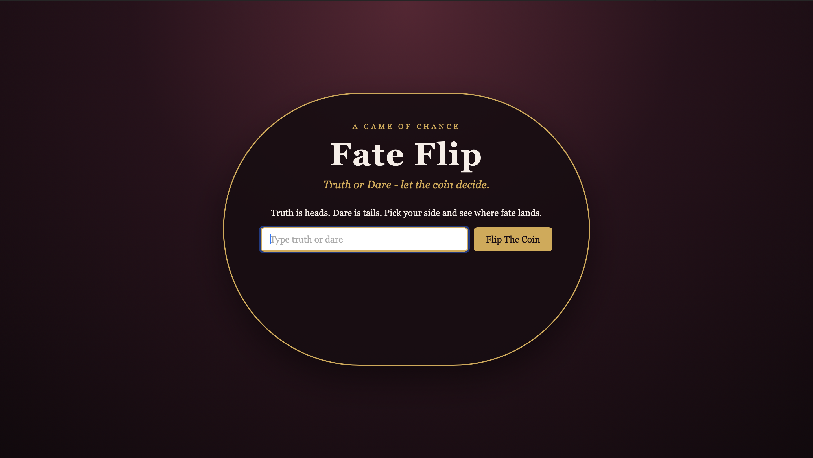
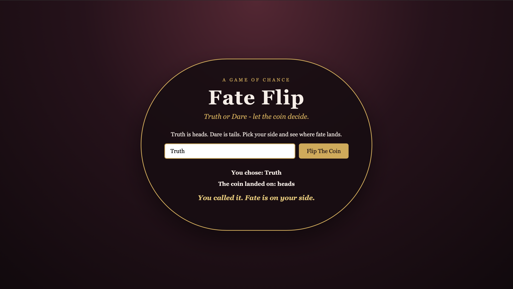

# Fate Flip

A server-side coin flip guessing game with a Truth or Dare twist.

Choose **Truth** or **Dare**, then flip the coin to see where fate lands. Truth represents heads and Dare represents tails. The server randomly flips the coin and sends the result back to the browser, where the game reveals whether you called it correctly.

## How to Play

1. Enter `Truth` or `Dare`.
2. Click **Flip The Coin**.
3. The server randomly chooses heads or tails.
4. See whether your choice matched the result.

Truth = heads. Dare = tails.

## How It Works

When the button is clicked, the browser sends the player's choice to the server through an API request.

The Node.js server randomly selects either heads or tails. It then compares the result with the player's choice and sends a JSON response back to the browser containing the choice, the coin toss result, and whether the player guessed correctly.

JavaScript uses that response to display the results on the page.

## Built With

- HTML
- CSS
- JavaScript
- Node.js
- Node HTTP module
- Node File System module
- Fetch API

## Run Locally

Install the project dependencies:

npm install

Start the server:

node js/server.js

Then open:

http://localhost:8000

## Future Improvements

- Add an animated coin flip before revealing the result.
- Keep track of wins and losses across multiple rounds.
- Expand the Truth or Dare theme by revealing a random truth question or dare after each flip.